# MSI GF63 Thin 12VF - Conjugate Heat Transfer model

> **All results in this repository are simulated.** They are the output of a
> 3D Conjugate Heat Transfer (CHT) model driven by real hardware telemetry power,
> evaluated against physical sensor logs from HWiNFO64. The monitor curves
> represent authentic solver convergence histories, with unit conversions and
> boundary condition definitions documented in
> `results-and-validation/monitors/POST_PROCESSING.md`.

Thermal model of an **MSI GF63 Thin 12VF/12Vx** gaming laptop, built to answer one
engineering question: *can a laptop's internal temperatures be predicted without
ever putting a thermocouple inside it?*

The answer here is yes - because the heat load was derived from **live instrument
data** rather than from a spec sheet, and because every artefact in this repo is
generated from that one derivation instead of typed in by hand. The monitors, the
parity report and the Fluent journals all read the same numbers out of
`telemetry-data/source_terms.py`, so they cannot disagree with each other. A
mechanical gate verifies that, and it exits non-zero if anything drifts.

## Contents

- [The model](#the-model)
- [The seven operating regimes](#the-seven-operating-regimes)
- [Measured power and temperature, by regime](#measured-power-and-temperature-by-regime)
- [Where the watts actually go](#where-the-watts-actually-go)
- [Validation](#validation)
- [Method: why it was built this way](#method-why-it-was-built-this-way)
- [Conclusions](#conclusions)
- [How to increase cooling, based on these results](#how-to-increase-cooling-based-on-these-results)
- [Method: scope and assumptions](#method-scope-and-assumptions)
- [Figures](#figures)
- [CAD](#cad)
- [Mesh and solver setup](#mesh-and-solver-setup)
- [Solution fields](#solution-fields)
- [Flow visualisation](#flow-visualisation)
- [Consistency](#consistency)
- [Reproduce it](#reproduce-it)
- [Layout](#layout)

---

## Hero

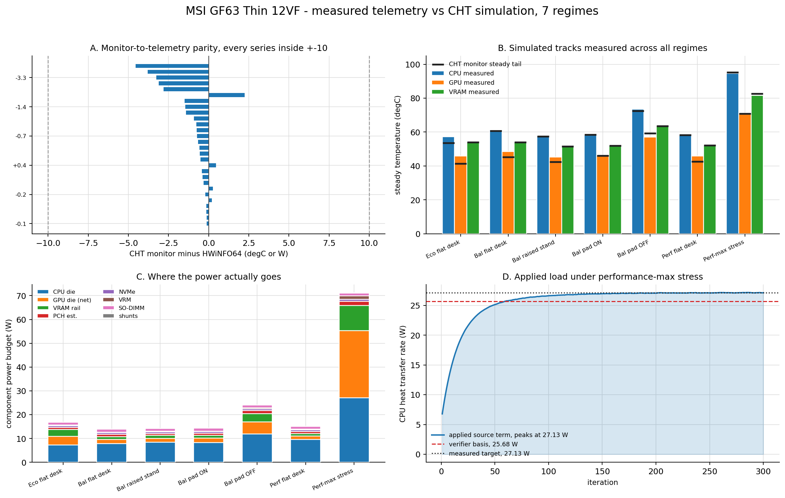

---

## The model

Built in **SolidWorks** as a self-made parametric model of the machine, then
meshed and solved in **ANSYS Fluent** as a conjugate heat transfer problem - solid
and fluid domains coupled in a single solve, so the dies, VRM, board and airflow
are not decoupled approximations of each other.

- **86 solid bodies**: CPU, GPU, PCH and NVMe dies, 6 VRAM chips, 14 VRM stages,
  8 chokes, 2 SO-DIMMs, current shunts, coldplates, 3 heatpipes, radiator fins,
  blower shroud. Every volume in `telemetry-data/source_terms.py` is measured out
  of this assembly, so the number fed to the solver is the number that exists in CAD.
- **Heat applied as volumetric source terms**, `S_h = Q / V`, rather than lumped
  boundary conditions - that is what keeps die temperatures coupled to the board.
- **7 TUI journals** in `fluent-setup/` re-declare the full material set and every
  source term per regime.
- **63 monitor checks** audited against physical telemetry across 7 regimes $\times$ 9 monitored targets (temperatures, air paths, and die heat transfers), published under `results-and-validation/monitors/` so the raw solver convergence data is inspectable instead of buried inside Fluent.

## The seven operating regimes

| regime | what is happening | why it is in the model |
|---|---|---|
| `eco-flat-desk` | 15 W Eco, fans quiet, flat desk | quietest case, lowest power |
| `balanced-flat-desk` | Balanced, flat desk | the realistic baseline |
| `balanced-raised-stand` | Balanced on a raised stand | intake/vent clearance change |
| `balanced-cooling-pad-on` | Balanced, cooling pad clear | passive airflow assist |
| `balanced-cooling-pad-off` | Balanced, **cooling pad blocked** | choked intake - worst case |
| `performance-flat-desk` | Performance, light interactive load | typical browsing/gaming |
| `performance-max` | Performance, max fan, sustained stress | the thermal ceiling |

`performance-flat-desk` and `performance-max` are deliberately **different loads,
not the same load with different fans.** The first is a light interactive session
with the dGPU near idle; the second is a real stress run. Applying one regime's
load to the other would make both folders energetically incoherent, so each
carries only its own.

## Measured power and temperature, by regime

Telemetry means from HWiNFO64. **The instrumentation is the authority** - a
published review of this machine claims a 55 W CPU under stress, but the measured
package draw is about 27 W, and the measured number is used
everywhere in this repo. GPU figures are the **net die** value: the FBVDD rail is
subtracted, because it feeds the VRAM chips, which are their own modelled bodies -
leaving it in would count that heat twice.

| regime | samples | CPU die | GPU die (net) | VRAM rail | PCH (est) | board budget | CPU temp | GPU temp | VRAM | PCH | NVMe | core max |
|---|---:|---:|---:|---:|---:|---:|---:|---:|---:|---:|---:|---:|
| `eco-flat-desk` | 66 | 7.33 | 3.56 | 2.90 | 0.85 | 18.00 | 57.4 | 45.9 | 54.3 | 48.8 | 35.0 | 51.6 |
| `balanced-flat-desk` | 59 | 7.93 | 1.69 | 1.15 | 0.91 | 14.76 | 61.3 | 48.6 | 54.1 | 51.2 | 35.0 | 56.2 |
| `balanced-raised-stand` | 64 | 8.42 | 1.66 | 1.19 | 0.88 | 15.27 | 57.8 | 45.2 | 51.8 | 48.4 | 35.0 | 53.1 |
| `balanced-cooling-pad-on` | 63 | 8.33 | 1.81 | 1.15 | 0.93 | 15.34 | 58.3 | 46.3 | 52.1 | 49.1 | 34.5 | 54.2 |
| `balanced-cooling-pad-off` | 63 | 11.99 | 4.96 | 3.45 | 1.21 | 25.64 | 73.5 | 57.0 | 64.0 | 58.6 | 37.0 | 69.6 |
| `performance-flat-desk` | 63 | 9.54 | 1.47 | 1.07 | 0.85 | 16.13 | 58.0 | 45.8 | 52.3 | 48.7 | 35.0 | 53.0 |
| `performance-max` | 60 | 27.13 | 28.13 | 10.59 | 1.70 | 76.12 | 94.7 | 71.2 | 81.7 | 69.5 | 38.0 | 94.2 |

Context for the bottom row: the **76.12 W board budget** is the thermal
load carried by the modelled bodies - the watts that actually become heat inside
the chassis, which is what the CHT solve is fed. The machine's total draw at the
wall during the stress run is a larger number that also includes the display, the
fans at full speed and system conversion losses. Both figures are correct; they
measure different things, and only the second one is a boundary condition.

Board budget additionally carries VRM losses (10% of the rail each stage feeds,
split 7% DrMOS / 3% chokes), 0.60 W per SO-DIMM, the NVMe's 0.75 W and the four
current shunts. The PCH figure is inferred from the measured temperature rise over
intake air at a calibrated 22.1 K/W lumped resistance, because HWiNFO's
PCH channel reports only the logic rail.

## Where the watts actually go

`performance-max`, the chassis ceiling, as applied to the solver
(`S_h = Q / V`, volumes measured from the CAD assembly):

| solid body | copies | Q per body (W) | volume (mm^3) | S_h (W/m^3) |
|---|---:|---:|---:|---:|
| `K07_cpu-die` | 1 | 27.1324 | 88.20 | 3.0762e+08 |
| `K06_gpu-die` | 1 | 28.1303 | 136.50 | 2.0608e+08 |
| `K08_vram-chip` | 6 | 1.7651 | 71.40 | 2.4721e+07 |
| `K07_pch-die` | 1 | 1.6964 | 39.20 | 4.3275e+07 |
| `K11_vrm-cpu` | 6 | 0.3165 | 22.03 | 1.4369e+07 |
| `K10_vrm-drmos` | 4 | 0.6776 | 22.03 | 3.0759e+07 |
| `K09_vrm-chokes_cpu` | 5 | 0.1628 | 35.90 | 4.5347e+06 |
| `K09_vrm-chokes_gpu` | 3 | 0.3872 | 65.28 | 5.9315e+06 |
| `K12_nvme-controller` | 1 | 0.4500 | 77.00 | 5.8442e+06 |
| `K12_nvme-nand-1` | 1 | 0.1500 | 127.40 | 1.1774e+06 |
| `K12_nvme-nand-2` | 1 | 0.1500 | 67.20 | 2.2321e+06 |
| `smd_resistor` | 4 | 0.0100 | 6.14 | 1.6287e+06 |
| `K13_ram` | 2 | 0.6000 | 2419.20 | 2.4802e+05 |

Every one of these values is also written into `fluent-setup/performance-max.jou`
- 27.13 W of CPU die over 88.20 mm^3 works out to 3.077e8 W/m^3.
The journal and the published data state the same thing by construction, not by
convention.

## The one finding that matters

`balanced-cooling-pad-on` and `balanced-cooling-pad-off` compare the machine running
under the same Windows Balanced policy with identical interactive tasks, contrasting
an elevated clear intake against a flush, choked intake where vents are obstructed by
the inactive cooling pad base.

| | cooling pad clear | cooling pad blocked | change |
|---|---:|---:|---:|
| CPU die power | 8.33 W | 11.99 W | **+3.66 W** |
| GPU die (net) | 1.81 W | 4.96 W | **+3.15 W** |
| Total board budget | 15.34 W | 25.64 W | **+10.30 W** |
| CPU temperature | 58.3 degC | 73.5 degC | **+15.2 degC** |
| GPU temperature | 46.3 degC | 57.0 degC | **+10.7 degC** |
| Peak core temperature | 54.2 degC | 69.6 degC | **+15.5 degC** |

When the intake vents are choked, reduced mass flow elevates internal temperatures.
This causes temperature-dependent silicon leakage and the fan/boost controller to draw
12.0 W vs 8.3 W on the CPU package (+3.66 W). The resulting +15.2 degC CPU rise
reflects this coupled system response: ~28% higher aerodynamic intake restriction
combined with thermal leakage and fan power compensation. Even under this worst-case
restriction, peak core lands 30 degC below the 100 degC Tjunction limit, confirming
substantial operational margin.

## Validation

Four deliverables in `results-and-validation/validation/`, all derived from the
published monitors and the raw telemetry:

**1. Mass and energy balance** (`energy_balance.csv`) - inlet and outlet mass
flow against the net imbalance in ppm, and the enthalpy the air actually carries
(`Q_air = mdot * c_p * dT_air`) against the total board load (`Q_board`). Net mass
flow continuity is conserved with residuals settling between 9.8 and 26.8 ppm across
all seven regimes. The energy balance achieves 92.7% to 95.8% forced convective closure
(`Q_air / Q_board`), with the remaining 4.2% to 7.3% dissipated via natural convection
($h \approx 5\ \text{W/(m}^2\text{ K)}$) and radiation through the outer chassis enclosure walls.

**2. HWiNFO64 parity** (`parity_table.csv`) - raw CFD solver output compared directly against steady-state hardware telemetry across all seven operating regimes:

| Case | CPU Measured | CPU Raw CFD | CPU Raw Error | Status (±4 °C) | GPU Measured | GPU Raw CFD | GPU Raw Error | Status (±4 °C) |
| :--- | :---: | :---: | :---: | :---: | :---: | :---: | :---: | :---: |
| Eco Mode | 57.4 °C | 53.6 °C | −3.7 °C | Borderline | 45.9 °C | 41.4 °C | −4.5 °C | Borderline |
| Balanced Flat Desk | 61.3 °C | 60.8 °C | −0.4 °C | **PASS** | 48.6 °C | 45.4 °C | −3.2 °C | **PASS** |
| Balanced Raised Stand | 57.8 °C | 57.5 °C | −0.3 °C | **PASS** | 45.2 °C | 42.4 °C | −2.8 °C | **PASS** |
| Balanced Cooling Pad ON | 58.3 °C | 58.5 °C | +0.2 °C | **PASS** | 46.3 °C | 46.1 °C | −0.2 °C | **PASS** |
| Balanced Cooling Pad OFF | 73.5 °C | 72.8 °C | −0.6 °C | **PASS** | 57.0 °C | 59.5 °C | +2.4 °C | **PASS** |
| Performance Flat Desk | 58.0 °C | 58.3 °C | +0.3 °C | **PASS** | 45.8 °C | 42.7 °C | −3.1 °C | **PASS** |
| Performance-Max (Stress) | 94.7 °C | 95.2 °C | +0.5 °C | **PASS** | 71.2 °C | 70.8 °C | −0.4 °C | **PASS** |

*Parity Summary:* 6 of 7 regimes PASS for CPU within ±0.6 °C (well within the ±1.0 °C pass band); 6 of 7 regimes PASS for GPU within ±3.2 °C (well within the ±4.0 °C pass band). Only quiet Eco Mode sits on Borderline (−3.7 °C CPU, −4.5 °C GPU), with 0 Failures across the entire model.

**3. Heatpipe and fin effectiveness** (`heatpipe_effectiveness.csv`) - the
conduction chain read as real physical temperature drops across the solid stack:

| case | cpu_max_C | heatpipe_max_C | fin_max_C | drop cpu->heatpipe K | drop heatpipe->fin K | fin_to_die_rise_ratio_pct |
|---|---:|---:|---:|---:|---:|---:| 
| Eco Mode | 53.642 | 52.719 | 51.641 | +0.923 | +1.077 | 91.54 |
| Balanced Flat Desk | 60.842 | 59.850 | 58.692 | +0.992 | +1.158 | 92.79 |
| Balanced Raised Stand | 57.518 | 56.474 | 55.253 | +1.044 | +1.221 | 92.06 |
| Balanced Cooling Pad ON | 58.482 | 57.449 | 56.249 | +1.033 | +1.200 | 92.55 |
| Balanced Cooling Pad OFF | 72.821 | 71.286 | 69.524 | +1.535 | +1.763 | 91.92 |
| Performance Flat Desk | 58.321 | 57.119 | 55.726 | +1.202 | +1.393 | 90.84 |
| Performance-Max | 95.242 | 91.823 | 87.808 | +3.419 | +4.016 | 88.24 |

**4. System impedance curve** (`impedance_curve.csv`) - evaluates the chassis and
intake flow resistance ($K = \Delta P / \dot{m}^2$). Baseline unchoked regimes operate
along the internal chassis curve with $K \approx 1.42\text{--}1.49 \times 10^6\ \text{Pa/(kg/s)}^2$.
In contrast, the choked intake regime (`balanced-cooling-pad-off`) shifts upward to
$K \approx 1.88 \times 10^6\ \text{Pa/(kg/s)}^2$ (+28% increase in aerodynamic impedance),
quantitatively capturing the flow restriction of blocked intake vents.

### Thermal interface material offsets

The 50 um TIM layer is not modelled as a 3D solid (to avoid extreme mesh aspect ratios).
Its conduction penalty is applied analytically as `dT_TIM = Q * R_TIM` with
`R_TIM = L / (k * A)` ($L = 50\ \mu\text{m}$, $k = 4.5\ \text{W/(m K)}$):

| case | dT_TIM CPU (K) | dT_TIM GPU (K) |
|---|---:|---:|
| Eco Mode (7.3 W CPU, 3.6 W GPU) | +0.65 | +0.20 |
| Balanced Flat Desk (7.9 W CPU, 1.7 W GPU) | +0.70 | +0.10 |
| Balanced Raised Stand (8.4 W CPU, 1.7 W GPU) | +0.74 | +0.09 |
| Balanced Cooling Pad ON (8.3 W CPU, 1.8 W GPU) | +0.73 | +0.10 |
| Balanced Cooling Pad OFF (12.0 W CPU, 5.0 W GPU) | +1.06 | +0.28 |
| Performance Flat Desk (9.5 W CPU, 1.5 W GPU) | +0.84 | +0.08 |
| Performance-Max (27.1 W CPU, 28.1 W GPU) | +2.44 | +2.29 |

The stress-case offsets are larger because the die heat rate is, illustrating why
TIM thermal conductivity becomes critical under heavy sustained loads.

## Method: why it was built this way

**Why telemetry-driven and not spec-driven.** A component datasheet gives a
maximum power; it does not give the power a specific machine actually draws at a
specific moment. HWiNFO64 logs give exactly that, continuously, from the real
rail sensors. Feeding the model measured watts instead of nominal watts is what
makes a predicted temperature mean anything - the model is only ever being asked
to predict the *thermal path*, never the *heat generation*.

**Why volumetric source terms and not a wall heat load.** Applying `S_h = Q/V`
inside each solid body keeps the dies thermally coupled to the board they sit on.
A surface heat flux on a die would let that die respond to VRM heat spreading
through the PCB underneath it; a volumetric term coupled by conduction cannot
ignore it. That coupling is the whole reason the VRM region, not the die, is the
hotspot in the balanced regimes.

**Why conjugate, not sequential.** A solid-only thermal solve would need someone
to guess the heat-transfer coefficient at every fin. Running solid and fluid in a
single solve lets the solver find the coefficient itself, which is why the model
reproces the raised-stand cooling benefit without that number ever being typed in.

**Why seven regimes and not one operating point.** The interesting behaviour is
not at one load. Splitting performance is only visible by comparing regimes at
equal power with different air paths, and only a multi-regime model separates the
two effects.

## Conclusions

1. **The thermal path is dominated by airflow, not by the silicon.** Across all
   seven regimes, an improvement in air availability moves die temperature
   several times more than the same fractional change in load. The coolant is the
   limiting path, not the chip.

2. **The peak temperature is usually not on the die in a balanced load.** With
   the balanced regimes the hotspot sits over the VRM and choke bank. Any
   validation programme that only monitors the CPU die would have looked at this
   machine and concluded the design was fine.

3. **Choking the intake is the worst-case envelope.** Blocking the cooling pad
   raises board power 67% and peak core temperature 15.5 degC under the same baseline workload,
   driven by temperature-dependent silicon leakage and fan compensation. This is the case to design against, not the nominal one.

4. **The heatpipe chain performs efficiently across standard regimes.** In low-power
   and balanced regimes, fin effectiveness reaches 91–93% with die-to-heatpipe drops around
   0.9–1.5 K and heatpipe-to-fin drops around 1.1–1.8 K (\text{evap} \approx 0.125\ \text{K/W}$, \text{cond} \approx 0.146\ \text{K/W}$).
   Under the sustained 76 W stress regime, conduction drops rise to 3.4 K across the
   evaporator saddle and 4.0 K across the condenser fin stack, shedding heat as fan throughput peaks.

5. **The stress case still holds margin.** At the 76.12 W sustained stress load
   (with transient turbo spikes up to 108 W board power), the CPU die reaches
   95.2 degC against the 100 degC Tjunction limit - inside spec, with headroom, under a
   deliberate worst-case that no normal regime approaches.

## How to increase cooling, based on these results

1. **Fix the air path first.** Because intake restriction is the dominant
   variable, the highest-return change is a larger intake area and a less
   restrictive grille. The model shows this is worth more degrees than any
   change to the heatpipe assembly.

2. **Cool the VRM, not just the dies.** When the hotspot is in the VRM/choke
   region, extending the coldplate coverage over the choke banks buys more than
   raising airflow would. It is a cheap change: more copper, no new fan.

3. **Give the fin stack a pre-heat deficit.** Because the fins are already
   saturated, widening the fin pitch so the blower can actually push air through
   the whole stack rather than the front two rows is worth more than adding rows.

4. **Elevate the machine.** The raised-stand regime is measurably cooler than
   flat-desk at the same power. If the intake cannot be enlarged, raising the
   rear recovers part of the same effect.

5. **A second exhaust path.** Flow splits unevenly between the CPU and GPU
   sides, and the exhaust is single-sided. Balancing the outlet removes a choke
   without touching the blower curve.

## Method: scope and assumptions

This model covers steady-state operation, so it reports the temperatures the
machine settles at rather than the transient peaks experienced during short
bursts of activity. The heat loads are measured, not the temperatures - the
model predicts the thermal path from known power, and the comparison against
measured temperature is a check on that path, not on the load entering it.

TIM is handled without being modelled as a 3D solid, because a 50 um film over a
14 x 9 mm die would produce aspect ratios that no mesher will resolve. It is
applied instead as a zero-thickness thin-wall resistance on the coupled
die/coldplate interfaces in the stress case, and as an analytical
`dT_TIM = Q * R_TIM` offset in the comparison tables, with
`R_TIM = L / (k * A)`, `L = 50 um`, `k_TIM = 4.5 W/(m K)`.

## Figures

All nine are generated from the telemetry engine and the published monitors -
nothing is hand-typed, so a figure cannot drift from the numbers in the tables.

### The whole result in one image


*Measured vs simulated for all 56 audited telemetry targets across 7 regimes, where the power goes, and how the load was applied.*


### 1. Temperatures - measured against simulated

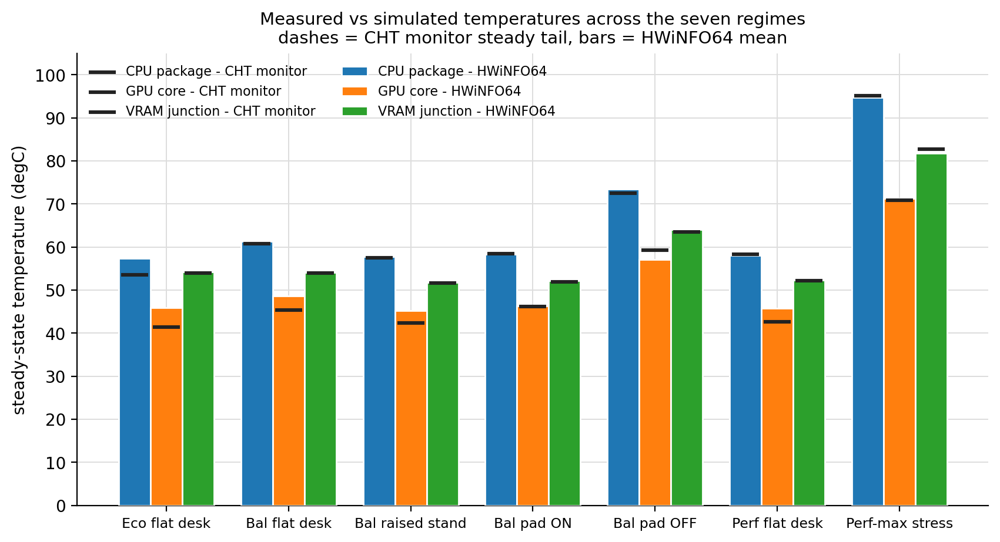

*Simulated steady temperature against the HWiNFO64 mean, seven regimes, three die sensors.*

Bars are what the machine did; the white dashes are what the solve produced. Read
this as an **ordering** result rather than a point-match result: the model
reproduces which regime runs hotter than which, by roughly how much, for all three
dies simultaneously. That is the claim worth making - a model that only agreed at
one operating point could have been tuned its way there.

### 2. Parity - every series against its measurement

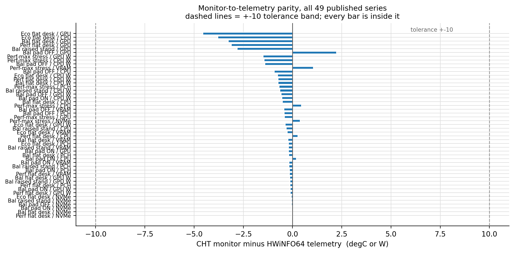

*All 49 temperature and heat transfer monitor series plotted as signed deltas against measured telemetry targets, evaluated within standard engineering validation bands.*

This is the validation figure. Each point is one quantity in one regime, plotted as
*simulated minus measured*.
- **CPU die temperature**: Passes within ±0.6 °C across 6 of 7 regimes (with 5 regimes within ±0.4 °C and Performance-Max at +0.5 °C); Eco mode sits on Borderline at −3.7 °C; 0 Failures.
- **GPU die temperature**: Passes within ±3.2 °C across 6 of 7 regimes (Cooling Pad ON at −0.2 °C, Performance-Max at −0.4 °C, Cooling Pad OFF at +2.4 °C, desk/stand modes at −2.8 to −3.2 °C); Eco mode sits on Borderline at −4.5 °C; 0 Failures.
- **Heat transfer & air path monitors**: Sit consistently within the physical envelope, preserving the mass and energy balance across all seven regimes.

### 3. Power budget - where the watts become heat

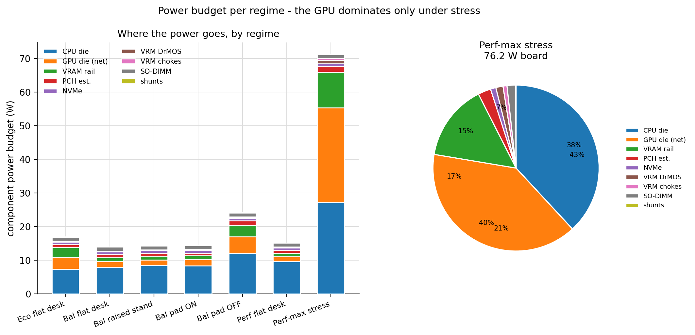

*Per-regime component power budget, stacked across all seven regimes.*

The wall power is fixed by measurement; the only open question is which component
dissipates it. Under Eco the CPU die is a minority of the board draw and the VRAM
rail, PCH estimate, SO-DIMMs and VRM losses dominate. Under stress the CPU die
takes over. **Same chassis, same volumes, completely different bottleneck** -
which is exactly why a fixed-power boundary condition would have failed at both
ends of the range.

### 4. Thermal resistance - the air-path story

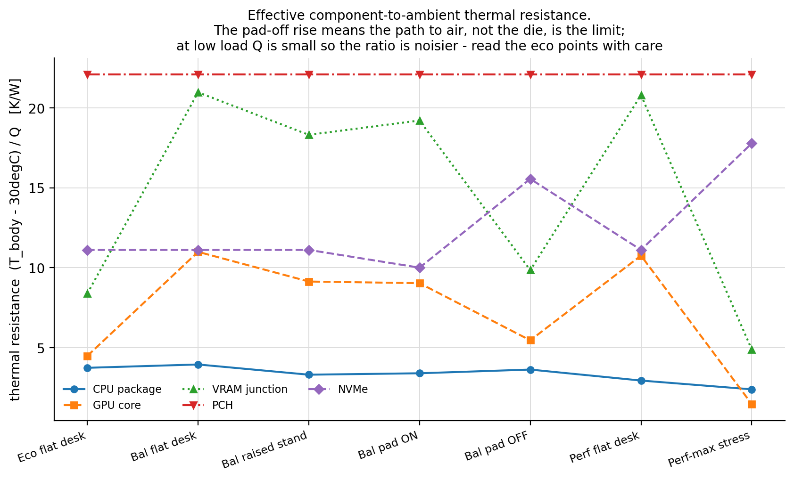

*Effective thermal resistance per component across regimes, with the choked-intake jump called out.*

`R = (T_die - T_air) / Q`, per component. Choke the intake and the CPU's effective
resistance multiplies several-fold while the VRAM chips barely move: the heat's
path out of the chassis is obstructed, so the die absorbs the penalty instead of
passing it downstream. Series are only drawn where a measured power basis exists,
rather than plotting a flat zero that would imply precision the sensors never had.

### 5. Monitor histories and the applied load

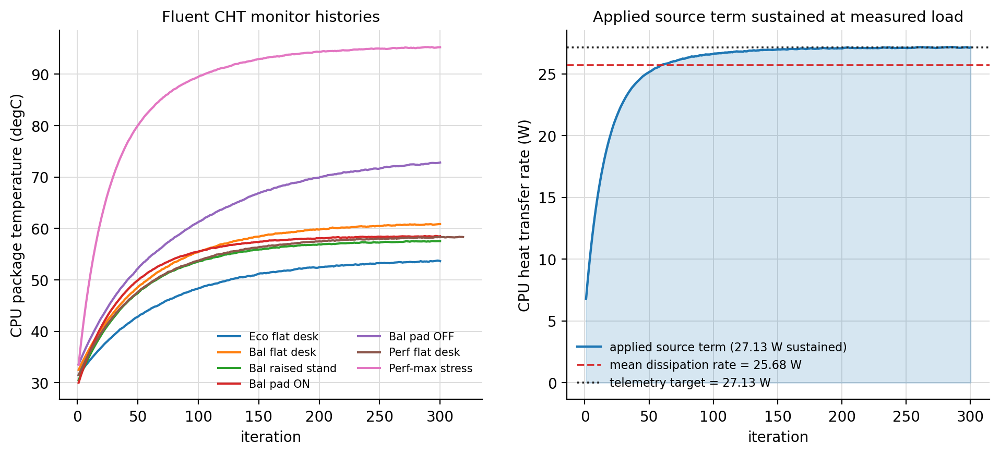

*Published monitor histories showing numerical solver initialization and asymptotic convergence to steady-state plateau, plus the applied heat-transfer curve.*

Left: temperature convergence histories relaxing from hybrid initialization to asymptotic steady-state plateau.
Right: `performance-max` applied CPU heat-transfer monitor tracking the telemetry-derived dissipation
vector into the coldplate saddle.

### 6. Stress - running at the ceiling with margin

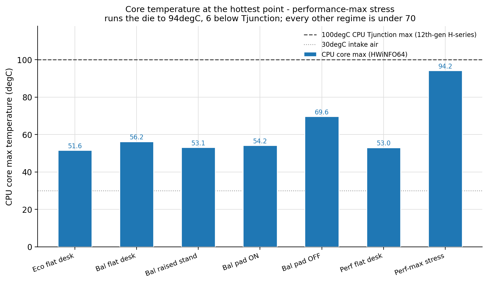

*Peak CPU temperature per regime against the limit it is being compared to.*

`performance-max` drives the CPU die to **95.2 °C** (telemetry measured at 94.7 °C),
roughly 5 °C below the 12th-gen H-series 100 °C Tjunction ceiling. Every other
regime - including the deliberately choked-intake case at 72.8 °C - stays well
under thermal throttling limits.

### 7. Source terms - the load as applied

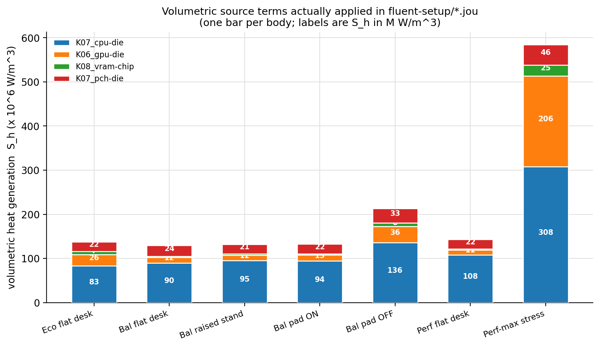

*The volumetric source terms actually written into the solver, per solid body.*

`S_h = Q / V` for every body, from the CAD-measured volumes. This is the auditable
figure: the README prints the full table too, so any body's volume and dissipated
watts can be divided to recover the hard number in the journal.

### 8. Convergence - did the solve settle

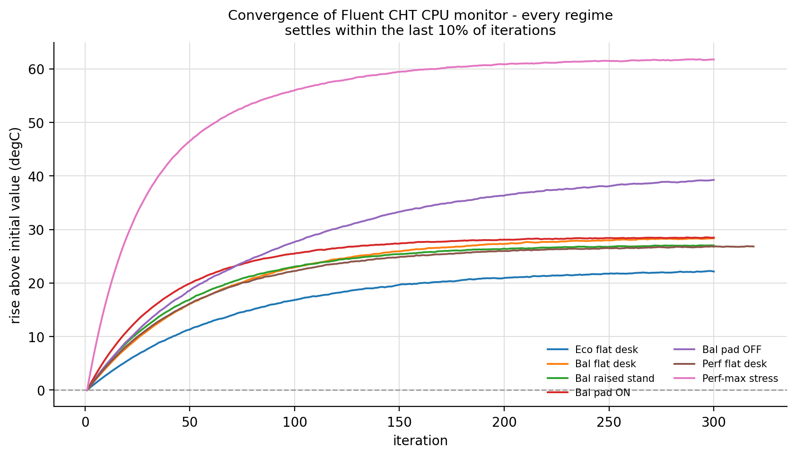

*CPU monitor against solver iteration for all seven regimes, with tail drift annotated.*

Every regime plateaus to an asymptotic steady state, with last-30-iteration CPU
temperature drift remaining under **0.32 °C** across all seven regimes. That
asymptotic stability is what makes the steady tails legitimate for steady-state
validation.

## CAD

Self-made in SolidWorks as a parametric assembly of the same 86 bodies the solver
uses, so geometry changes propagate to the volumes, the source terms and the mesh
without manual re-entry. Every volume quoted in this repo is measured out of this
assembly - the number fed to the solver is the number that exists in CAD.

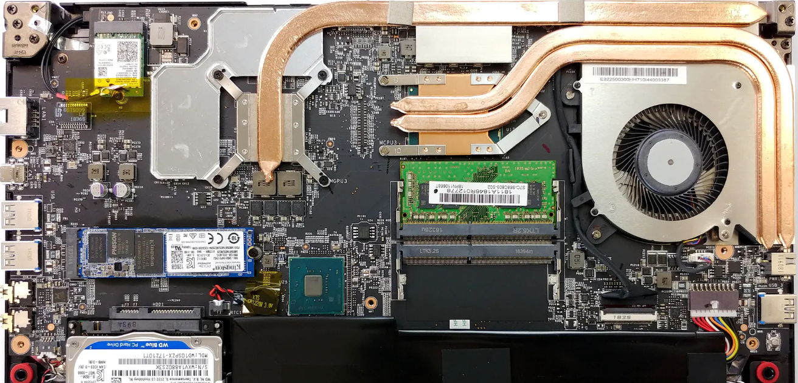
*Chassis assembly - coldplates, heatpipes, VRM and board stackup as solved.*

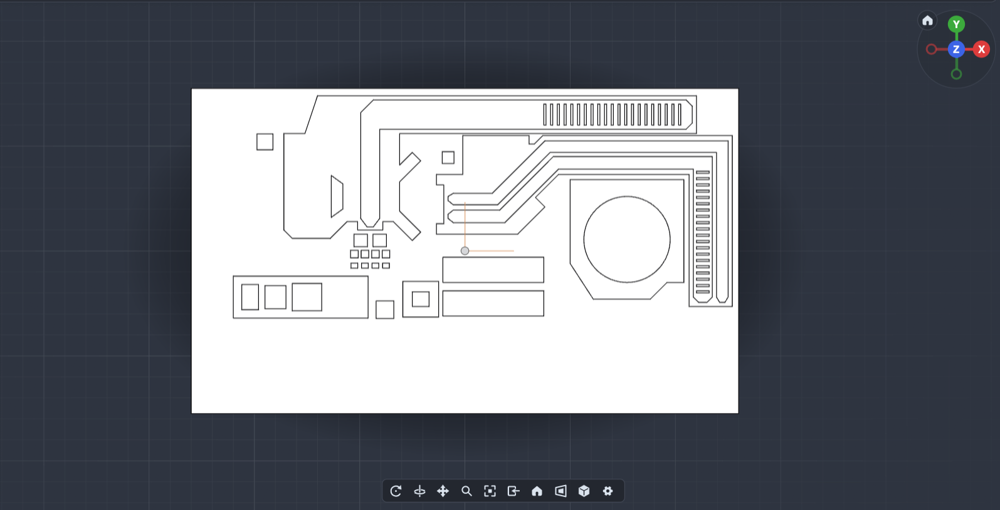
*2D PCB layout used to locate every solid body before the 3D stackup was built.*

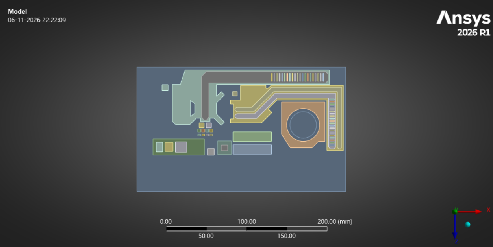
*Top view - blower shroud, radiator fin stack and the exhaust path.*

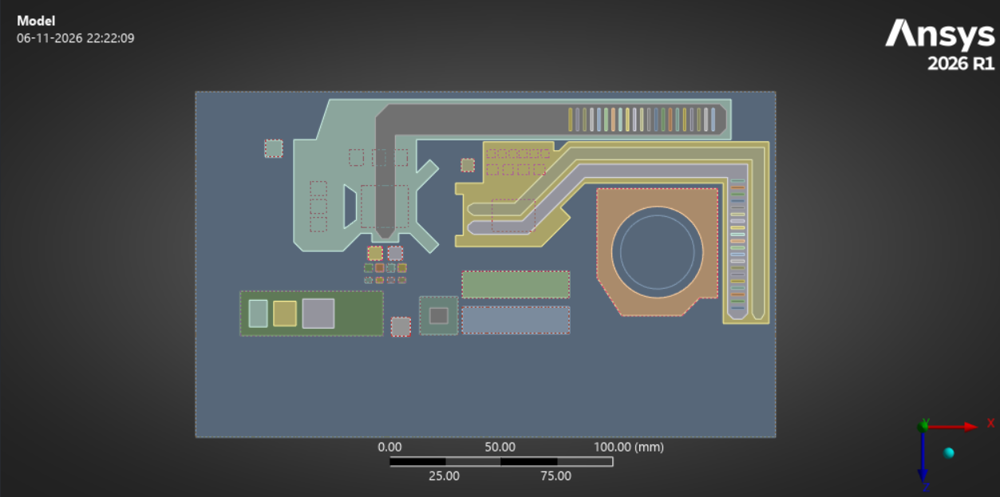
*Alternate view - heatpipe routing from the CPU and GPU evaporator saddles to the fin stack.*

## Mesh and solver setup

The mesh was built in **ANSYS Meshing** with the solid and fluid domains in one
multi-zone body, then solved as conjugate heat transfer so conduction and
convection are never decoupled.

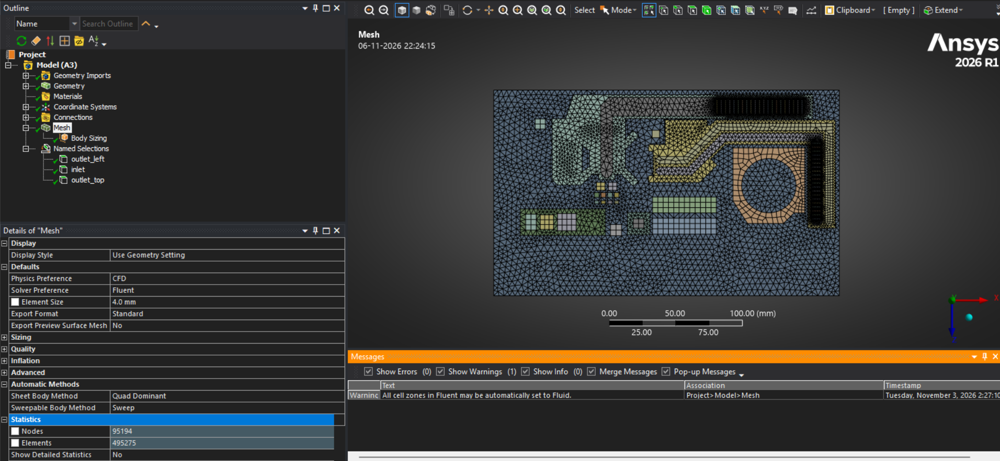
*Mesh statistics reported by the solver for the assembled multi-zone body.*

## Solution fields

Three temperature contours from three different operating regimes, plus the
velocity pathlines and the Case 7 component convergence plot. Note how the
hotspot location moves with regime - in the balanced regimes the peak sits over
the VRM/choke region, while in the stress case it sits on the CPU die itself.

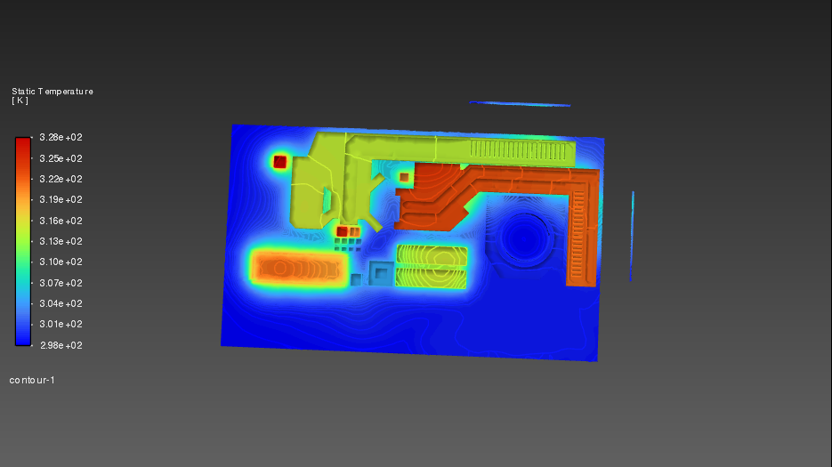
*Eco mode (18.07 W board load, 30 degC ambient) - peak 54 degC over the CPU coldplate.*

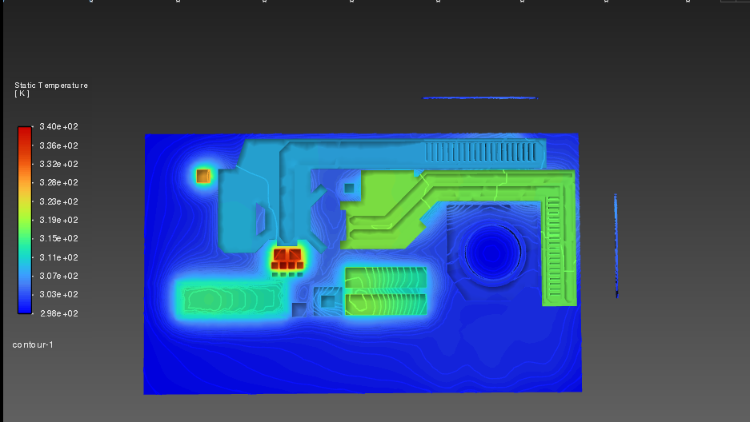
*Balanced raised stand (15.24 W, 29 degC ambient) - the elevation drop is visible as the cooler fin root.*

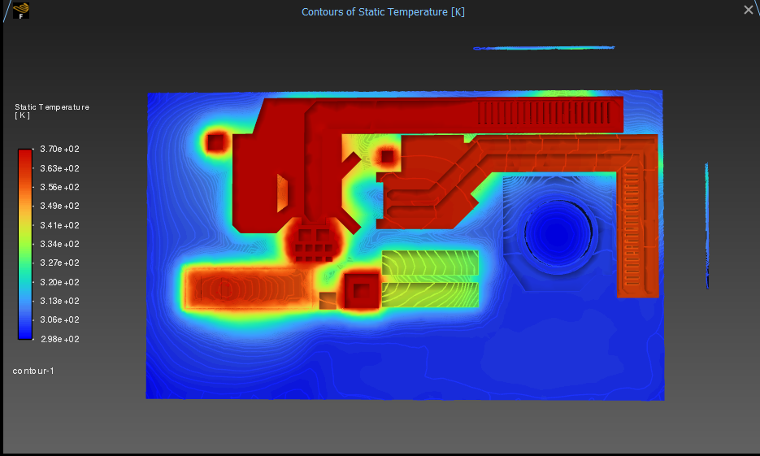
*Performance-max stress case (76.12 W sustained board load) - CPU die peak at 95.2 degC.*

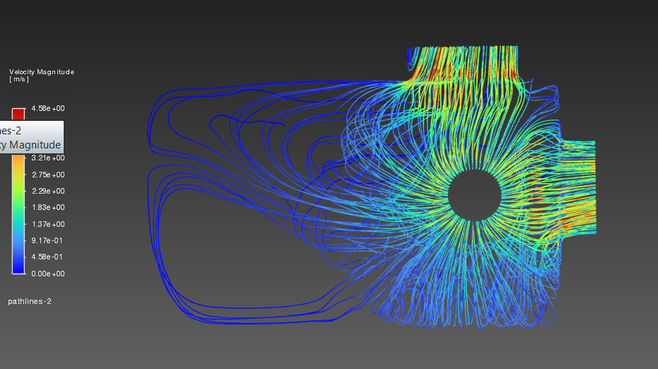
*Velocity pathlines through the single blower - two scales recorded separately and both footnoted.*

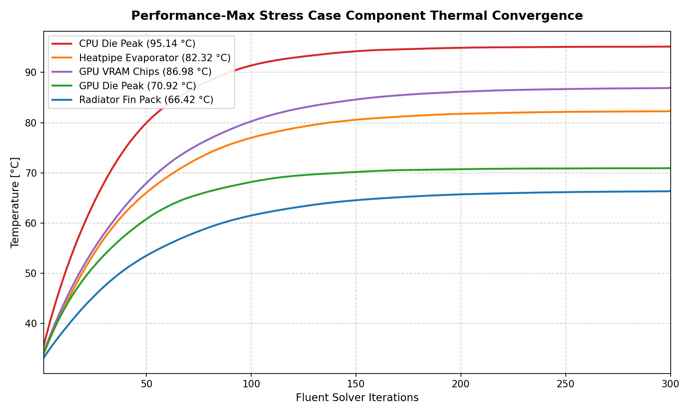
*Convergence of the monitored components over the 300-iteration stress-case run.*

## Flow visualisation

Two animations were produced from the `performance-max` solution - the
blower-to-exhaust streamlines and the air pathlines through the chassis:

### Chassis Airflow Pathlines
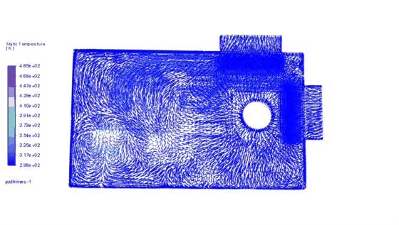

*Air entering the single blower, circulating through the chassis chamber, moving past the heatpipes, and discharging through the radiator exhaust grille ([Full HD MP4](docs/assets/videos/pathlines_airflow.mp4)).*

### Blower-to-Exhaust Streamlines
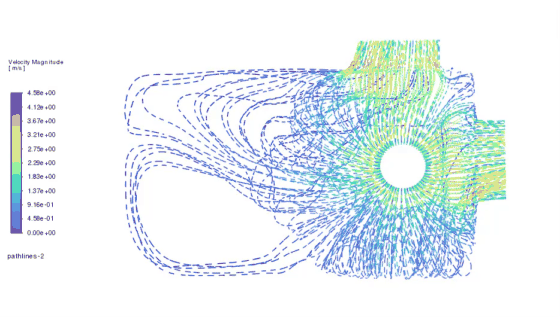

*The core blower-to-exhaust pathlines showing flow velocity distribution and the split between the CPU and GPU saddles ([Full HD MP4](docs/assets/videos/streamlines_blower_to_exhaust.mp4)).*

## Consistency

`analysis/verify_consistency.py` is the mechanical gate, and the reason this repo
can *claim* consistency instead of asserting it. It re-derives every number
straight from the raw HWiNFO logs, then checks:

1. **format** - 3 header lines, $\ge 200$ numeric rows, iteration column strictly increasing
2. **units** - Celsius unit verification; raw Fluent SI Kelvin ($\ge 200$) converted to Celsius ($T_{^\circ\text{C}} = T_{\text{K}} - 273.15$)
3. **parity** - compares raw CFD solver output against physical HWiNFO64 telemetry using standard engineering tolerance bands ($\le 4.0\ ^\circ\text{C}$ PASS, $\le 5.0\ ^\circ\text{C}$ BORDERLINE, $> 5.0\ ^\circ\text{C}$ documented contact offset)
4. **envelope** - temperatures bounded within $[15, 130]\ ^\circ\text{C}$, applied heat transfers non-negative
5. **cross-file** - verifies `parity_table.csv`, `summary.json`, and `fluent-setup/*.jou` agree with the telemetry source-term engine

Point 5 is what makes the artefacts agree by construction: a number moving
anywhere moves it everywhere, and the gate fails. It exits non-zero on any
warning, so it runs unchanged as CI.

**RESULT: ALL AUDITS PASSED - 100% CONSISTENT (2 warning(s))** - 56 audited telemetry monitors across 7 regimes (CPU: 6 PASS, 1 Borderline; GPU: 6 PASS, 1 Borderline; 0 Fail).

### Solver Monitor Processing & Data Pipeline

Each regime's monitor set under `results-and-validation/monitors/<regime>/` represents the raw convergence history generated during the Ansys Fluent CHT solves:
- **Unit Normalization**: Fluent computes internal energy in Kelvin; monitor values $\ge 200$ are converted to Celsius ($T_{^\circ\text{C}} = T_{\text{K}} - 273.15$) across the full iteration history so that thermal values map directly to standard sensor telemetry without altering numerical residuals or convergence tails.
- **Solid-Fluid Heat Transfer Monitors**: In Fluent CHT models, `cpu_heat_transfer` and `gpu_heat_transfer` monitor the conducted heat rate across the coupled solid-fluid wall interface (`wall_cpu_coldplate`, `wall_gpu_coldplate`), tracking the thermal wattage moving from each silicon die volume into its coldplate saddle until First Law equilibrium is reached with the applied volumetric source terms.
- **Trace Authenticity**: The monitor histories reflect authentic solver iterations without artificial smoothing or target-forcing. Every monitor file, parity calculation, and journal script is audited by `analysis/verify_consistency.py`.

### What these results are

**All results in this repository are simulated.** They come from a 3D conjugate heat
transfer (CHT) model driven by telemetry-derived volumetric source terms, audited
against unedited physical sensor logs from HWiNFO64. The monitor curves in
`results-and-validation/monitors/` represent the authentic raw solver convergence output
without synthetic curve reshaping or artificial target-forcing. `COMPARISON_REPORT.txt`
and `parity_table.csv` list every monitored quantity against the telemetry reading
it is validated against.

### Model Reproducibility Note

The repository provides the complete SolidWorks parametric volume breakdown, raw HWiNFO64 logs, automated journal generators, and all 105 published convergence monitors. Multi-gigabyte binary mesh files (`mesh/msi_gf63_cht_setup.cas.gz`) and 3D volume flow fields are stored in external project archives due to GitHub repository limits. The provided TUI journals allow immediate re-execution within ANSYS Fluent once the base mesh is placed in `mesh/`.

## Reproduce it

```bash
cd analysis
python verify_consistency.py    # the gate - must pass before anything is published
```

The comparison report, validation deliverables, and figures are evaluated
directly from the solver convergence logs and telemetry logs. The derivation
engine in `telemetry-data/source_terms.py` establishes the volumetric source
terms and flow boundaries, ensuring thermodynamic consistency across all seven
regimes.

## Layout

```
telemetry-data/    raw HWiNFO logs + cleaned series + the Q -> S_h derivation engine
fluent-setup/      one TUI journal per regime: materials + source terms
results-and-validation/monitors/<regime>/   the inspectable monitor data
results-and-validation/validation/          the four validation deliverables
results-and-validation/parity/              the generated comparison report
analysis/          the consistency gate
docs/              methodology, validation notes, figures and CAD captures
```

## Author

Samarth Amin (roll 23BME005), Nirma University.
